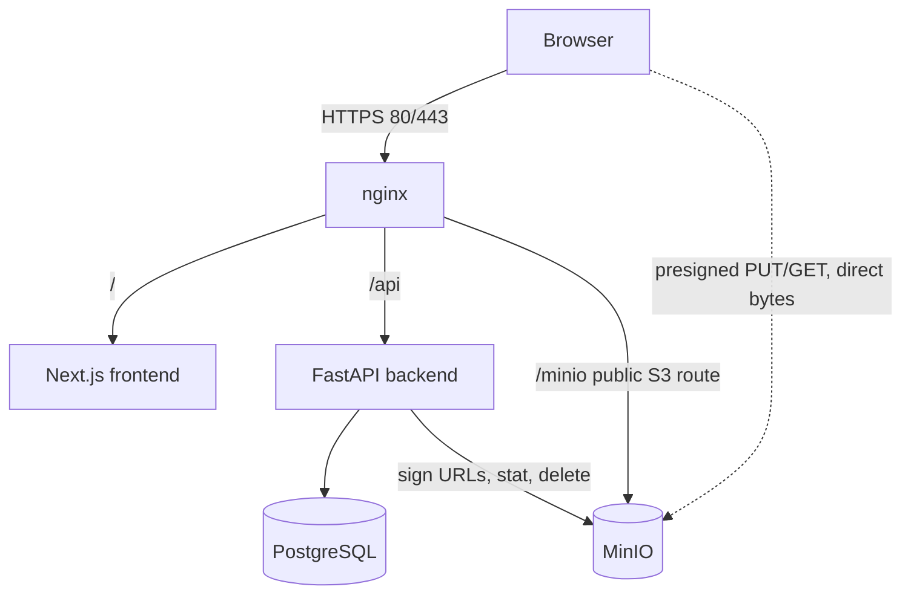
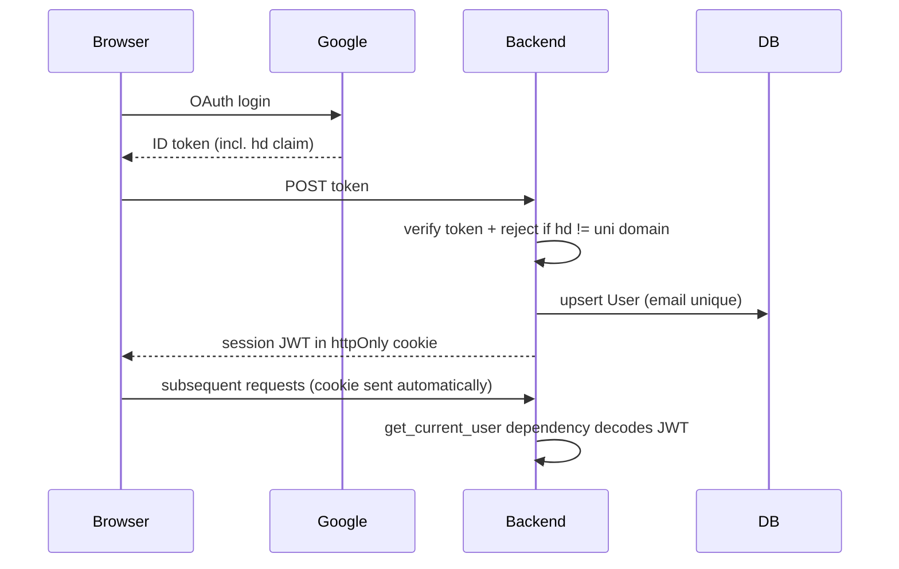

# Architecture

How the system's parts talk. Read [CLAUDE.md](CLAUDE.md) first for the hard rules these flows must obey.

## Component map

Key point: the browser talks to MinIO **directly** for file bytes (the dotted line). FastAPI only authorizes requests and mints presigned URLs — it never proxies bytes.

## Upload flow

Presigned PUT + client-confirms + cleanup. Steps:

1. Client requests an upload slot (project id, declared filename, declared size, mime).
2. Backend **declared-size check** (advisory): reject early if `declared_size > MAX_FILE_SIZE` or over quota.
3. Backend writes a `File` row with `status='pending'`, the sanitized `object_key`, and the original `filename`.
4. Backend issues a **presigned PUT URL** with a `content-length-range` policy so MinIO itself rejects an oversized upload (enforcement #2).
5. Browser PUTs the bytes **directly to MinIO**.
6. Browser calls the **confirm endpoint** for that File id.
7. Confirm endpoint: verify the caller owns the project (else reject), then `stat_object` for the **authoritative actual size** (enforcement #3). If over the limit → delete the MinIO object + the row, return error.
8. Otherwise flip `status='ready'`. File is now visible.

Three size enforcement points: (1) declared-size pre-check, (2) `content-length-range` on the presigned policy, (3) `stat_object` at confirm — #3 is authoritative.

## Download flow

Presigned-for-everything. No permanent public URLs.

1. Client requests a file (or a project's files).
2. Backend **authorizes by visibility, not by login**:
   - Project `is_public=true` → allow even an anonymous caller (no JWT).
   - Project private → require a valid JWT **and** caller is owner or staff.
3. Backend mints a **short-lived presigned GET URL**.
4. Browser fetches bytes directly from MinIO.
5. **No client-side URL caching.** URLs expire; re-mint on demand. A stale URL returns 403 — the frontend must re-request, not reuse.

> Note: "every fetch goes through FastAPI auth" means auth **checks visibility**, it does not **require login**. Public visitors are unauthenticated and still get URLs for public projects. The bucket is never anonymously readable — the presigned signature is the only way in.

## Blog content + media resolution

- Project write-ups are **TipTap JSON** stored in `projects.content` (JSONB). The backend validates on save: whitelisted node types only, and every media node's file id must belong to that project (rejects foreign/unknown ids).
- Media nodes store **File ids, never URLs** — presigned URLs expire in minutes, so a stored URL would rot. Rendering a project page: fetch the project → collect embedded file ids → one batch call (`POST /projects/{id}/media-urls`) mints short-lived GET URLs for all of them → render. Videos play from a presigned `<video src>`.
- `files.kind` separates **media** (embedded in the write-up) from **attachment** (downloads area). Both use the identical presigned upload flow; only where the UI surfaces them differs.
- Avatars (`users.avatar_file_id`) and covers (`projects.cover_file_id`) are ordinary File rows through the same flow — no separate path.

## Landing curation model

- `projects.slider_pinned` (bool): staff pins a project into the landing slider. Slider feed = pinned public projects first, remaining slots filled randomly from public projects with a cover image. **Private projects never appear**, pinned or not.
- `projects.featured_rank` (nullable int): non-null = featured, ordered ascending. Staff sets/reorders via the admin dashboard.
- Both are pure DB writes; curation of a project that later goes private simply drops out of the feeds (the queries filter `is_public`).

## Cleanup job lifecycle

Mandatory cron. Sweeps orphans left when a browser uploads but never confirms (or never uploads after a row is created).

1. Select `File` rows where `status='pending' AND created_at < now() - 1 hour`. Uses the composite `File(status, created_at)` index.
2. For each: delete the MinIO object (ignore "not found" — the upload may never have landed).
3. Delete the row.

## Auth / JWT flow

- **`hd` claim check is non-negotiable** — without it any Gmail account logs in.
- JWT stored in an **httpOnly cookie** (not localStorage) to limit XSS token theft. Doesn't conflict with MinIO — presigned URLs are signature-authed, not cookie-authed.
- Keep a clean **`get_current_user` dependency** so the auth mechanism stays swappable.
- **Role is not in the Google token.** Plan for manual staff assignment via an allowlist/admin table. Default new users to `student`.

## Docker / nginx topology

- **Only nginx publishes ports** (80/443). frontend, backend, db, minio are internal on the Docker network.
- **Exception: MinIO needs a public S3 route through nginx**, because the browser hits presigned URLs directly. Its endpoint can't be internal-only or uploads/downloads break.
- **MinIO's configured public endpoint must match the public URL nginx serves**, or presigned signatures won't validate.
- Raise nginx **`client_max_body_size`** on the MinIO route, or large presigned PUTs die at the proxy before reaching MinIO.
- **Bucket CORS must allow the frontend origin on PUT and GET**, or browser uploads/downloads fail with CORS errors.
- `depends_on` controls boot order but **does not wait for DB readiness** — the backend needs retry-on-connect for Postgres.
- Backups: `pg_dump` on cron.

## Secrets

All in a gitignored `.env`, read via Compose `env_file`.

| Secret | Used by |
|---|---|
| DB credentials | backend, db |
| MinIO root credentials | backend, minio |
| Google OAuth client secret | backend |
| JWT signing secret | backend |

## Known gaps (loud, on purpose)

- **MinIO objects are not backed up.** `pg_dump` saves metadata only. Single-node MinIO on one VM = single point of failure; if the disk dies, every file is gone and the DB points at nothing. Backup strategy is **deferred (TODO)** pending IT confirming VM/storage capabilities — same as disk quotas.
- **Public presigned URLs defeat browser/CDN caching.** Every public image re-fetches behind a fresh mint. Accepted for v1; optimize (batch minting, longer public TTL, thumbnail caching) only if it actually hurts.
- **`owner_id ON DELETE RESTRICT` blocks offboarding.** A user who owns projects can't be hard-deleted. Known v1 limitation; revisit post-v1.
